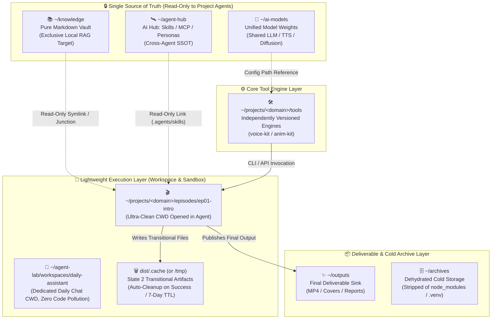

# AI-First Workspace Architecture (`ai-first-workspace`)

> 🌐 **Language / 語言**: **English** | [繁體中文 (zh-TW)](./README.zh-TW.md)  
> 🛡️ **License**: [MIT](./LICENSE) | ✅ **Zero Dependencies** (Python 3 Stdlib) | 🧪 **Tests**: 17/17 Passing (`python -m unittest discover -s tests -v`)

**Stop burning 4,000–20,000+ context tokens per turn on messy monorepos—and stop letting AI agents dump tangential side-quests into your clean project directories.**

A cross-platform directory architecture, legacy folder refactoring methodology, real-time token/disk auditor (`audit-workspace.py`), and AI governance skill (`SKILL.md`) designed for **Multi-Agent Collaboration (Antigravity, Claude Code, Cursor, Custom Agent Harnesses)**, **Local Personal RAG**, and **Generative Media Pipelines (TTS / Video / ComfyUI)**.

---

## ⚡ 3-Second Quick Start: Catch Your Hidden Token & Disk Hogs (100% Read-Only)

Before moving a single file, run our zero-dependency auditor to scan your home directory and open an **interactive bilingual (`EN / 繁中`) Dry-Run Heatmap Simulator** in your browser:

```bash
# English UI default (instant EN / 繁中 toggle inside the web UI)
python3 scripts/audit-workspace.py --lang en --open

# Traditional Chinese (繁體中文) UI default
python3 scripts/audit-workspace.py --lang zh --open

# Check any project repo for "CWD Dumping" (stray side-projects, personal plans, or weights)
python3 scripts/audit-workspace.py --check-repo . --lang en
```

- 🔥 **Amber Token Heatmap (Multi-Agent Aware)**: Measures actual `CLAUDE.md`, `AGENTS.md`, `GEMINI.md`, `.agents/`, `.claude/`, `.cursorrules`, `.cursor/rules/*.mdc`, `.windsurfrules`, `.clinerules`, and `copilot-instructions.md` files to expose repos burning **4,000–20,000+ tokens per turn** (with itemized per-file token bills).
- 💎 **Emerald Disk Heatmap (Multi-Language Aware)**: Measures actual `node_modules`, `.venv`, `target` (Rust), `.gradle`, `.turbo`, `coverage`, and `.cache` bloat in MB/GB.
- 🧠 **Smart Container Unrolling & Content-Based Heuristics**: Automatically unpacks generic parent folders (`~/workspace`, `~/dev`, `~/repos`, `~/code`, or any multi-project container) and classifies folders by internal file signatures (`.obsidian` / pure Markdown vaults, `.gguf` / `.safetensors` weights, pure `.mp4` / `.wav` media)—even when folder names are vague.
- 🌳 **Final Tree Preview & Legacy Search**: Preview your refactored 5-layer tree and search any legacy folder name to see where it lands.
- 💊 **1-Click Lossless Rollback Script**: Automatically generates both `migrate-apply` (Move + Leave Symlink/Junction) and `migrate-rollback` (1-Click Undo) scripts for macOS/Linux and Windows PowerShell.
- 🎮 **Try the Sample Report Without Running Anything**: Open [`examples/demo-report.html`](./examples/demo-report.html) in any browser.

---

## 1. Why Traditional Directory Structures Fail in the AI Era

Most developers organize their home directory by **OS era (`WindowsWorkspace` / `MacWorkspace`)** or **monolithic project folders (stuffing reference notes, tool source code, model weights, intermediate render frames, and final MP4s into a single folder)**. In an era of multi-agent collaboration and local RAG, this causes five major disasters:

1. **Context Pollution & Invisible Token Tax**:
   When an AI Agent starts, it scans the current working directory (CWD) and auto-loads `.agents/skills`, `.claude/`, `CLAUDE.md`, and `AGENTS.md`. Opening a daily chat assistant inside a massive application repository—or mixing reference docs and thousands of cached images—wastes **4,000 to 20,000+ tokens per turn** and degrades reasoning focus.
2. **SSOT Corruption & Accidental Overwrites**:
   When multiple projects share domain notes or agent skills via copy-pasting, updates quickly desynchronize. Conversely, linking them without a read-only contract allows a project agent to accidentally mutate your global Single Source of Truth (SSOT).
3. **Artifact Bloat Crushing Git & Disks**:
   Generative media pipelines (TTS audio slices, Remotion PNG sequences, ComfyUI intermediate outputs) generate transitional files **10–50x larger** than final deliverables. Keeping them inside project repos breaks Git and exhausts disk space.
4. **Path Escaping Hell (Spaces & Non-ASCII Paths)**:
   Legacy folders with spaces (e.g., `AI L2`, `My Project`) or non-ASCII characters frequently break unquoted CLI scripts, Docker volume mounts, and LLM tool calls across Bash and PowerShell.
5. **Agent "CWD Dumping" of Side-Projects & Global Tools**:
   When you ask an AI agent for a quick side-utility, global IDE customization, or personal audit while working inside Project A, an ungoverned agent lazily dumps those unrelated files directly into Project A's root—polluting a clean repo with tangential artifacts.

---

## 2. The Federated AI-First Architecture

We propose a **5-layer core decoupled storage architecture (plus 2 auxiliary sandbox/archive zones, forming 7 top-level directories)** using strict lowercase `kebab-case` naming, assembled dynamically at runtime via read-only Symlinks / Windows Directory Junctions, and governed by a 3-state artifact lifecycle.

### 2.1 At a Glance: Full Directory Tree & Dynamic Task Assembly

See how the 5 layers stay 100% isolated on disk while dynamically assembling inside a lightweight execution workspace (`episodes/ep01-eval-metrics/`):

```text
~/ (or %USERPROFILE%\)
│
├── 📚 knowledge/study/ml-notes/          # [1. Knowledge Vault: SSOT (Read-Only)]
│   └── ch01-evaluation-metrics/
│       └── f1-score-and-auc.md           # Pure Markdown/PDF notes (100% noise-free Local RAG target)
│
├── 🧠 ai-models/tts/custom-voice/        # [2. Model Weights: SSOT (Read-Only Ref)]
│   └── voice-weights.safetensors         # Shared LLM / TTS / Diffusion weights (never duplicated)
│
├── 🛰️ agent-hub/skills/                  # [3. Shared Agent Capabilities: SSOT (Read-Only)]
│   ├── brand-visual-style/               # Skill: Brand colors, typography & tone guidelines
│   └── script-to-video/                  # Skill: SOP for converting scripts into scene JSON
│
├── 🧪 agent-lab/workspaces/              # [4. Clean Agent Sandbox (Zero-Pollution CWD)]
│   └── daily-assistant/                  # Open daily chat here to save thousands of context tokens
│
├── 🚀 projects/media-studio/             # [5. Production Zone: Engines vs. Task Runs Separated]
│   ├── tools/                            # ⚙️ Core Engines (Pure code in Git; no episode assets)
│   │   ├── voice-kit/                    # TTS synthesis CLI engine
│   │   └── anim-kit/                     # Video & animation rendering engine
│   │
│   └── episodes/ep01-eval-metrics/       # ★ [Open THIS lightweight folder in Antigravity / Claude!]
│       ├── .agents/skills/               # 🔗 Read-Only Link -> ~/agent-hub/skills/brand-visual-style
│       ├── knowledge/                    # 🔗 Read-Only Link -> ~/knowledge/study/ml-notes/ch01-evaluation-metrics
│       ├── AGENTS.md                     # 🛡️ Guardrail: Declares external links read-only; write only locally
│       ├── prompt.md                     # 📝 State 1 (Git Tracked): Task instructions & goals
│       ├── script.md                     # 📝 State 1 (Git Tracked): AI-generated narration script
│       ├── scenes.json                   # 📝 State 1 (Git Tracked): AI-generated scene storyboard
│       └── dist/                         # 📦 Local build zone (Git-ignored)
│           └── .cache/                   # 🗑️ State 2 (Transitional): WAV slices & PNG frames (Auto-purge / 7-day TTL)
│
├── ✨ outputs/media-studio/              # [6. Final Deliverable Sink]
│   └── ep01-eval-metrics-final.mp4       # 🎬 State 3 (Final): Verified MP4, thumbnails & master audio
│
└── 🗄️ archives/2025-legacy-projects/     # [7. Dehydrated Cold Storage]
    └── old-prototype/                    # Legacy backups stripped of node_modules & .venv
```

### 2.2 Data Flow & Permission Boundaries



### 2.3 Conversational Sprawl vs. Spatial Routing (Anti-Dump Guardrail)

During AI collaboration, humans naturally spawn side-quests inside a single chat window. An agent equipped with `workspace-governance` enforces **Spatial Routing**—never dumping tangential files into the current repo:

| When you say mid-conversation inside Project A... | ❌ Ungoverned Agent (CWD Dump) | ✅ Governed AI-First Spatial Routing |
| :--- | :--- | :--- |
| *"Also build me a global IDE preview button / Skill"* | Dumps `plugin.json` & `sidecars/` inside Project A | Routes directly to `~/agent-hub/` or `~/.gemini/config/` (**0 repo pollution**) |
| *"Save this research summary as a note for later"* | Drops random `notes.md` in Project A's code root | Routes to `~/knowledge/<domain>/` for clean Local RAG indexing |
| *"Let's whip up a quick side-utility to test X"* | Mixes unrelated scripts into Project A's Git history | Creates a dedicated folder in `~/projects/<domain>/<tool>/` or `~/agent-lab/` |
| *"Audit my home folder and draft a private plan"* | Hides `.local/` inside a public Git repo | Routes private plans & reports to `~/agent-lab/workspaces/` |

---

## 3. Deep Comparison with Existing GitHub Proposals

| Dimension | 1. `agentsfolder/spec`<br/>(`.agents` Standard) | 2. `Agentic_Folders`<br/>(ThisIsPhantom) | 3. `ICM Methodology`<br/>(Sequential Folders) | 4. `personal-RAG`<br/>(PersonalRAGVault) | 5. `AI-First-Workspace`<br/>(Monorepo Template) | 🌟 **This Repo: Federated Architecture**<br/>(Multi-Agent + Media + RAG) |
| :--- | :--- | :--- | :--- | :--- | :--- | :--- |
| **Core Philosophy** | Standardizes `.agents/` inside a single repo | Coordinates agents via Layer 0–3 & Git Worktrees | Numbered folders (`01`, `02`) as prompt pipelines | Watches local docs and builds vector indices | Puts your entire life/company into one giant Git repo | **5-layer decoupled storage with dynamic runtime link assembly** |
| **Cross-Agent Compatibility** | ⭐⭐⭐⭐⭐<br/>Great intra-repo spec | ⭐⭐⭐<br/>Custom routing rules | ⭐⭐⭐<br/>Generic Markdown | ⭐⭐<br/>Local Q&A only | ⭐⭐⭐<br/>Single-workspace focus | ⭐⭐⭐⭐⭐<br/>**100% `.agents` compatible + `agent-hub` cross-tool SSOT** |
| **Cross-Project Reuse & SSOT Guard** | ⭐⭐<br/>Single repo only; requires copying across repos | ⭐⭐⭐<br/>Layered, but lacks read-only link guardrails | ⭐<br/>Isolated pipelines | ⭐⭐<br/>Static docs only | ⭐⭐⭐<br/>Shared in one repo, blurry permissions | ⭐⭐⭐⭐⭐<br/>**Declarative Symlink/Junction + `AGENTS.md` read-only guardrail** |
| **Context & Token Efficiency** | ⭐⭐⭐⭐<br/>Good inside single repo | ⭐⭐⭐⭐<br/>Worktree isolation | ⭐⭐⭐⭐<br/>Stage-by-stage reads | ⭐⭐⭐<br/>Chunk-based retrieval | ⭐<br/>**Fatal Flaw**: Monorepo bloat burns thousands of tokens | ⭐⭐⭐⭐⭐<br/>**Ultra-light task folders (4–5 files) + isolated `agent-lab` CWD** |
| **Local RAG Purity** | ⭐<br/>No code/knowledge split | ⭐⭐<br/>Mixed with projects | ⭐<br/>No global vault | ⭐⭐⭐⭐⭐<br/>Built for clean RAG | ⭐⭐<br/>Docs mixed with scripts | ⭐⭐⭐⭐⭐<br/>**Dedicated `~/knowledge` text vault, 100% isolated from code/models** |
| **Heavy Binary & Cache Control** | ❌ None | ❌ None (Text-only assumption) | ❌ None (Text-only assumption) | ❌ None | ❌ **Breaks Git** (Large binaries in repo) | ⭐⭐⭐⭐⭐<br/>**3-State Output: `/tmp` + Auto-Purge + 7-Day TTL + `~/outputs`** |

---

## 4. Practical Guide: How to Refactor Years of Legacy Mess

Never move legacy folders blindly by hand—hardcoded scripts and IDE shortcuts will break. Follow our **9 Legacy Symptom Refactoring Matrix** and **4-Phase Zero-Downtime Migration SOP**:

### 4.1 Legacy Folder Diagnosis & Refactoring Matrix (Before ➡️ After)

| Legacy Folder Symptom (Before) | Diagnosis | Target Location (After) | Refactoring Technique (How-To) |
| :--- | :--- | :--- | :--- |
| **Scattered Local Model Weights**<br/>(`.gguf`, `.safetensors`, TTS weights duplicated across repos) | Wastes hundreds of GBs | `~/ai-models/<category>/`<br/>(`llm/`, `tts/`, `checkpoints/`) | **Centralize**: Move all weights into `~/ai-models/` and point projects to them via config/env vars. |
| **Fragmented Skills & Prompts**<br/>(`claude-skills/`, ad-hoc `.agents/` across projects) | Desynchronized copies across repos | `~/agent-hub/skills/`<br/>`~/agent-hub/mcp/` | **Consolidate SSOT**: Keep one master copy in `agent-hub`; mount into projects via read-only links. |
| **Personal Notes, Study Guides & Resumes Mixed in Code Workspaces** | Pollutes local RAG vector indices with code and `node_modules` | `~/knowledge/<domain>/`<br/>(`study/`, `career/`, `tech-notes/`) | **Extract Pure Text**: Move `.md`, `.pdf`, `.txt` into `~/knowledge/` and rename spaces to `kebab-case`. |
| **Core Tool Code Mixed with Per-Episode Outputs** | Bloats Git repos; forces Agents to scan engine code during content creation | Engine: `~/projects/<studio>/tools/`<br/>Runs: `~/projects/<studio>/episodes/` | **Separate Engine & Runs**: Version tools independently; keep each episode in a lightweight folder calling the CLI. |
| **Top-Level Render & Temp Work Folders**<br/>(`render_work_01/`, `tts_temp/`) | Transitional WAV slices & PNG frames consume tens of GBs | Transitional: `dist/.cache/` or `/tmp/`<br/>Final: `~/outputs/<project>/` | **3-State Split**: Move final MP4s to `~/outputs/`, purge intermediate frames, keep text recipes in `episodes/`. |
| **Opening Daily Chat Assistants Inside Heavy Dev Repos** | Auto-loads dev `.agents/skills` & `CLAUDE.md`, burning 4k–20k+ tokens/turn | Source: `~/projects/<app>/`<br/>Daily Chat: `~/agent-lab/workspaces/<bot>/` | **CWD Sandbox Isolation**: Create a clean, empty CWD under `~/agent-lab/workspaces/` for daily assistant sessions. |
| **OS- or Era-Named Giant Folders**<br/>(`WindowsWorkspace/`, `MacWorkspace/`, `2023_Work/`) | Outdated taxonomy mixing unrelated domains and dead experiments | Domain subtrees under `~/projects/` (`media-ai/`, `engineering/`) | **Unpack by Domain**: Move active sub-projects into domain folders and leave compatibility Symlinks behind. |
| **Folder Names with Spaces or Non-ASCII Characters**<br/>(`AI L2/`, `My Work/`) | Breaks unquoted Bash/PowerShell commands & Docker mounts | Strict lowercase `kebab-case`<br/>(`ai-l2/`, `media-studio/`) | **Standardize Naming**: Rename to `kebab-case` at destination; leave a Symlink at the old path if legacy tools require it. |
| **Old Backups & Inactive Projects**<br/>(`Windows_Backup/`, `old_v1/`) | Hidden `node_modules` & `.venv` waste tens of GBs | `~/archives/<year>-<topic>/` | **Dehydrate & Archive**: Strip all rebuildable dependency folders (`node_modules`, `.venv`) before archiving. |

---

### 4.2 4-Phase Zero-Downtime Migration SOP (With Real Audit Simulator)

#### Phase 1: Run the Read-Only Auditor & Generate Your Interactive Dry-Run HTML Report
Before touching a single file, run [`scripts/audit-workspace.py`](./scripts/audit-workspace.py):
```bash
python3 scripts/audit-workspace.py --root ~/ --out-html ./dist/.cache/dry-run-report.html --open
```
- **Real Token Tax Breakdown**: Scans actual `CLAUDE.md`, `AGENTS.md`, `GEMINI.md`, `.agents/`, `.claude/`, `.cursor/rules/*.mdc`, `.windsurfrules`, `.clinerules`, and `copilot-instructions.md` files to compute the exact token overhead per folder.
- **Real Reclaimable Disk Space**: Measures actual `node_modules`, `.venv`, `target` (Rust), `.gradle`, `.turbo`, and `.cache` sizes in MB/GB.
- **Smart Container & Content Detection**: Automatically unrolls generic parent containers (`~/workspace`, `~/dev`, `~/repos`) and inspects internal file signatures (`.obsidian`, model weights, pure docs, media outputs).
- **Bilingual Interactive Dry-Run Simulator (`EN / 繁中` & `macOS / Windows`)**: Open `./dist/.cache/dry-run-report.html` to inspect every folder's target path, symlink guardrail, and exact migration commands before executing anything.

#### Phase 2: Initialize the Skeleton & Extract `knowledge` and `agent-hub` SSOT
```bash
mkdir -p ~/knowledge ~/agent-hub/skills ~/ai-models ~/projects ~/agent-lab/workspaces ~/outputs ~/archives
```
Extract scattered Markdown notes into `~/knowledge/<topic>/` and consolidate shared Agent Skills into `~/agent-hub/skills/`.

#### Phase 3: "Move Physical Folder + Leave Symlink/Junction Behind" (Zero Broken Paths)
- **macOS / Linux**:
  ```bash
  mkdir -p ~/projects/media-studio/tools
  mv ~/OldWorkspace/voice-kit ~/projects/media-studio/tools/voice-kit
  ln -sfn ~/projects/media-studio/tools/voice-kit ~/OldWorkspace/voice-kit
  ```
- **Windows (PowerShell — Admin-Free Directory Junction)**:
  ```powershell
  New-Item -ItemType Directory -Force -Path "$env:USERPROFILE\projects\media-studio\tools" | Out-Null
  Move-Item -LiteralPath "$env:USERPROFILE\OldWorkspace\voice-kit" -Destination "$env:USERPROFILE\projects\media-studio\tools\voice-kit"
  New-Item -ItemType Junction -Force -Path "$env:USERPROFILE\OldWorkspace\voice-kit" -Target "$env:USERPROFILE\projects\media-studio\tools\voice-kit" | Out-Null
  ```

#### Phase 4: Dehydrate Cold Archives & Purge Expired Render Caches
```bash
# 1. Preview rebuildable dependency folders inside ~/archives before removal
find ~/archives \( -name "node_modules" -o -name ".venv" -o -name "venv" -o -name "__pycache__" -o -name "target" -o -name ".gradle" \) -type d -prune

# 2. Purge transitional render caches older than 7 days (TTL Pruning)
find ~/projects -path "*/dist/.cache/*" -mtime +7 -delete
```

---

## 5. How to Use with Your AI Agent (1-Line Skill Install)

Install [`skills/workspace-governance/SKILL.md`](./skills/workspace-governance/SKILL.md) (along with `scripts/audit-workspace.py`) into your shared `~/agent-hub/skills/` SSOT and link it into your favorite AI Agent with a single idempotent command:

- **macOS / Linux (Claude Code, Antigravity, Cursor, Codex)**:
  ```bash
  mkdir -p ~/agent-hub/skills ~/.claude/skills ~/.agents/skills ~/.gemini/config/skills && rm -rf ~/agent-hub/skills/workspace-governance && cp -R skills/workspace-governance ~/agent-hub/skills/ && mkdir -p ~/agent-hub/skills/workspace-governance/scripts && cp scripts/audit-workspace.py ~/agent-hub/skills/workspace-governance/scripts/ && ln -sfn ~/agent-hub/skills/workspace-governance ~/.claude/skills/workspace-governance && ln -sfn ~/agent-hub/skills/workspace-governance ~/.agents/skills/workspace-governance && ln -sfn ~/agent-hub/skills/workspace-governance ~/.gemini/config/skills/workspace-governance
  ```
- **Windows (PowerShell — Admin-Free Junction)**:
  ```powershell
  New-Item -ItemType Directory -Force -Path "$env:USERPROFILE\agent-hub\skills", "$env:USERPROFILE\.claude\skills", "$env:USERPROFILE\.agents\skills", "$env:USERPROFILE\.gemini\config\skills" | Out-Null; Copy-Item -Recurse -Force ".\skills\workspace-governance" "$env:USERPROFILE\agent-hub\skills\"; New-Item -ItemType Directory -Force -Path "$env:USERPROFILE\agent-hub\skills\workspace-governance\scripts" | Out-Null; Copy-Item -Force ".\scripts\audit-workspace.py" "$env:USERPROFILE\agent-hub\skills\workspace-governance\scripts\"; New-Item -ItemType Junction -Force -Path "$env:USERPROFILE\.claude\skills\workspace-governance" -Target "$env:USERPROFILE\agent-hub\skills\workspace-governance" | Out-Null; New-Item -ItemType Junction -Force -Path "$env:USERPROFILE\.agents\skills\workspace-governance" -Target "$env:USERPROFILE\agent-hub\skills\workspace-governance" | Out-Null; New-Item -ItemType Junction -Force -Path "$env:USERPROFILE\.gemini\config\skills\workspace-governance" -Target "$env:USERPROFILE\agent-hub\skills\workspace-governance" | Out-Null
  ```

Then prompt your agent from anywhere:

> "Using the `workspace-governance` skill, run `~/agent-hub/skills/workspace-governance/scripts/audit-workspace.py` to audit my home directory `~/` (read-only, do not move any files yet), and show me the interactive HTML Dry-Run report and migration table."

---

## 6. Clean Foundation, Infinite Extensions (Bring Your Own Ecosystem)

This architecture intentionally **avoids vendor lock-in or bloated built-in viewers**. Instead, by enforcing a **100% noise-free, standardized directory foundation**, it unlocks external knowledge, visualization, and file management tools that previously choked on messy monorepos:

- **Obsidian (2D / 3D Graph View) & Logseq Users**: Point your Vault directly at `~/knowledge/`. Because `node_modules`, `.venv`, and transitional render caches are physically isolated in other layers, your knowledge graph opens instantly and renders pure domain connections—zero code-noise islands.
- **Local RAG & Personal Second Brain (`AnythingLLM`, `Open WebUI`, `Cursor @Docs`, `NotebookLM`)**: Mount `~/knowledge/` as your sole watch folder to achieve 100% signal-to-noise embedding indexing without wasting vector tokens on lockfiles or build artifacts.
- **Terminal File Managers & Launchers (`Yazi`, `zoxide`, `Raycast`, `Everything`)**: Strict lowercase `kebab-case` naming with zero spaces ensures `z ep01` or `z voice-kit` jumps to any workspace in milliseconds without shell-escaping failures.

---

## 7. Repository Structure

| Path | Description |
| :--- | :--- |
| [`README.md`](./README.md) / [`README.zh-TW.md`](./README.zh-TW.md) | Full architecture guide, 6-way GitHub comparison, and 4-phase migration SOP (English & Traditional Chinese). |
| [`skills/workspace-governance/SKILL.md`](./skills/workspace-governance/SKILL.md) | Portable AI Agent Governance Skill (compatible with Claude Code, Antigravity, Cursor, Codex). |
| [`scripts/audit-workspace.py`](./scripts/audit-workspace.py) | Zero-dependency Python 3 read-only workspace auditor, CWD anti-dump checker, and interactive HTML generator. |
| [`examples/demo-report.html`](./examples/demo-report.html) | Pre-generated interactive bilingual (`EN / 繁中`) Dry-Run Heatmap Simulator sample. |
| [`tests/test_audit_workspace.py`](./tests/test_audit_workspace.py) | 17 automated unit tests covering classification heuristics, container unrolling, repo purity, and XSS safety. |
| [`.github/workflows/test.yml`](./.github/workflows/test.yml) | Cross-platform GitHub Actions CI workflow (`ubuntu-latest`, `macos-latest`, `windows-latest`). |
| [`LICENSE`](./LICENSE) | MIT Open-Source License. |
