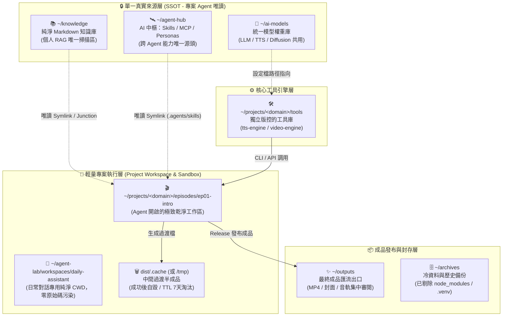

# AI-First Workspace Architecture (`ai-first-workspace`)

> 🌐 **Language / 語言**: [English](./README.md) | **繁體中文 (zh-TW)**  
> 🛡️ **開源授權**: [MIT License](./LICENSE) | ✅ **零外部依賴** (Python 3 內建標準庫) | 🧪 **單元測試**: 19/19 全數通過 (`python -m unittest discover -s tests -v`)

**別再讓混亂的家目錄每次對話偷燒 4,000～20,000+ Tokens，也別再讓 AI 把支線產物隨手傾倒在你的乾淨專案裡。**

一套專為 **多 AI Agent 協同（Antigravity、Claude Code、Cursor、自建 Agent Harness）**、**個人本地 RAG（檢索增強生成）** 與 **生成式多媒體流水線（TTS / Video / ComfyUI）** 設計的跨平台目錄重構指南、舊資料拆解方法論、實測體檢腳本與 AI 治理技能（`SKILL.md`）。

---

## ⚡ 3 秒快速體驗：抓出你電腦裡的隱形 Token 小偷與硬碟巨獸（100% 唯讀安全）

在動手搬移任何一個檔案前，先執行零依賴的體檢腳本，3 秒內自動在瀏覽器彈出**「中英雙語（`繁中 / EN`）互動式效益熱力圖模擬器」**：

```bash
# 預設以「繁體中文」開啟互動式熱力圖報告（網頁右上角可隨時一鍵切換 繁中 / EN）
python3 scripts/audit-workspace.py --lang zh --open

# 預設以「英文 (English)」開啟互動式熱力圖報告
python3 scripts/audit-workspace.py --lang en --open

# 檢查任一專案是否被 AI 混入「不屬於該專案的支線產物 (CWD Dumping)」並取得自動分流指令
python3 scripts/audit-workspace.py --check-repo . --lang zh
```

- 🔥 **琥珀金「省 Token 熱力圖」（支援多 Agent）**：實測掃描各目錄下的 `CLAUDE.md`、`AGENTS.md`、`GEMINI.md`、`.agents/`、`.claude/`、`.cursorrules`、`.cursor/rules/*.mdc`、`.windsurfrules`、`.clinerules` 與 `copilot-instructions.md` 字數，抓出每次對話偷燒 **4,000～20,000+ Tokens** 的大魔王（附每個檔案的 Token 帳單明細，省越多越亮）。
- 💎 **翡翠綠「省空間熱力圖」（支援多語言）**：實測計算殘留的 `node_modules`、`.venv`、`target` (Rust)、`.gradle`、`.turbo`、`coverage` 與 `.cache` 體積，一眼看出哪裡能釋放幾十 GB 空間。
- 🧠 **智慧容器展開 ＋ 內容特徵識別（Content-Based Heuristics）**：自動展開 `~/workspace`、`~/dev`、`~/repos`、`~/code` 等通用父容器（或任何內含多個子專案的容器），並能依據內部檔案特徵（如 `.obsidian` / 純 Markdown 筆記庫、`.gguf` / `.safetensors` 模型權重、純 `.mp4` / `.wav` 影音成品）精準歸位，不綁死資料夾名稱。
- 🌳 **最終新架構全景樹 ＋ 舊資料即時搜尋**：預覽搬完家後的五層架構長相，輸入任何舊資料夾名稱即可秒速定位新家位置。
- 💊 **內建「一鍵無損還原後悔藥（1-Click Rollback）」**：自動生成安全搬移腳本（搬實體＋原位留 Symlink/Junction）與一鍵還原腳本，100% 消除斷鏈恐懼。
- 🎮 **免執行直接試玩範例報告**：直接用瀏覽器打開 [`examples/demo-report.html`](./examples/demo-report.html) 即可體驗。

---

## 一、 為什麼傳統電腦目錄在 AI 時代會失靈？

在傳統電腦使用習慣中，人們習慣以**「作業系統時期（如 `WindowsWorkspace` / `MacWorkspace`）」**或**「單一專案大雜燴（把參考筆記、工具原始碼、模型權重、渲染半成品、最終影片全塞在同一資料夾）」**來管理檔案。但在多 Agent 與本地 RAG 協同的時代，這種做法會引發五大真實災難：

1. **上下文污染與 Token 隱形爆炸（Context Pollution）**：
   Agent 啟動時會自動掃描當前工作目錄（Workspace Root）與內部的 `.agents/skills`、`.claude/`、`CLAUDE.md`、`AGENTS.md`。若將日常對話助理直接開在龐大的開發原始碼目錄中，或工作區混雜了幾萬字的參考文件與上萬張渲染快取圖，每次對話都會白白多消耗 **4,000～20,000+ 無謂 Tokens**，甚至讓 Agent 迷失焦點。
2. **多源頭失步與逆向覆寫（SSOT Corruption）**：
   當多個專案共用同一份知識筆記或同一個技能（Skill）時，若採用複製貼上，改一處要手動改十處；若直接軟連結卻無權限護欄，Agent 可能會在執行單一專案時「順手改壞」全域正本。
3. **衍生快取吞噬硬碟與弄爆 Git（Artifact Bloat）**：
   AI 多媒體生成（如 TTS 語音切片 WAV、Remotion 逐格動畫 PNG、ComfyUI 中間圖）產生的過渡半成品往往是最終成品的 **10～50 倍大**，混在專案目錄中會導致 Git 儲存庫（Repo）崩潰、備份緩慢與磁碟耗盡。
4. **空白字元與非英文路徑引發工具鏈斷裂（Path Escaping Hell）**：
   舊資料夾常見的空白字元（如 `AI L2`、`My Project`）或跨系統非標準命名，在 Bash、PowerShell、Docker Volume 掛載與 AI Agent 工具呼叫（Tool Calling）時極易發生未加引號的路徑解析失敗。
5. **AI 助理的「就地傾倒症」（CWD Dumping of Side-Projects）**：
   當你在開發「專案 A」時，順口請 AI 幫你做一個「全域 IDE 小工具、跨專案 Skill 或個人分析報告」，沒有治理規範的 AI 會因為偷懶而**直接把支線檔案生在「專案 A」的目錄裡**，久而久之每個專案都混入一堆毫不相干的副產品。

---

## 二、 聯邦式 AI 目錄架構（Federated AI-First Architecture）

本架構提出**「五層核心儲存解耦（搭配日常沙盒與冷封存共 7 個頂層目錄）、全小寫 `kebab-case` 命名、執行時透過 Symlink/Junction 動態組裝、產出分流控管」**的設計。

### 1. 3 秒看懂：全景目錄樹與「單一任務動態組裝」解剖圖

看看當你要製作一集 AI 教學影片（或執行一個特定專案任務）時，五層架構如何在保持各自純淨的同時，在輕量工作區內瞬間完成組裝：

```text
~/ (或 %USERPROFILE%\)
│
├── 📚 knowledge/study/ml-notes/          # 【1. 知識源頭：SSOT (唯讀)】
│   └── ch01-evaluation-metrics/
│       └── f1-score-and-auc.md           # 純筆記與解析（本地 RAG 唯一掃描主體，零程式碼噪音）
│
├── 🧠 ai-models/tts/custom-voice/        # 【2. 模型資產：SSOT (唯讀引用)】
│   └── voice-weights.safetensors         # 專屬聲線與 LLM 權重（全系統共用，絕不重複複製）
│
├── 🛰️ agent-hub/skills/                  # 【3. 通用能力庫：SSOT (唯讀)】
│   ├── brand-visual-style/               # 規範：品牌配色、視覺規範與語氣口吻
│   └── script-to-video/                  # 技能：將講稿轉換成分鏡腳本的標準 SOP
│
├── 🧪 agent-lab/workspaces/              # 【4. 日常對話沙盒 (零污染 CWD)】
│   └── daily-assistant/                  # 日常問答在此開啟，不誤載開發專案 Skills，省下數千 Tokens
│
├── 🚀 projects/media-studio/             # 【5. 生產工作區：引擎與單次任務徹底分離】
│   ├── tools/                            # ⚙️ 核心工具庫（純程式碼獨立 Git 版控，不放單集素材）
│   │   ├── voice-kit/                    # TTS 語音合成 CLI 引擎
│   │   └── anim-kit/                     # 動畫與影片渲染引擎
│   │
│   └── episodes/ep01-eval-metrics/       # ★【這就是你在 Antigravity / Claude 開啟的輕量工作區！】
│       ├── .agents/skills/               # 🔗 唯讀軟連結 -> ~/agent-hub/skills/brand-visual-style
│       ├── knowledge/                    # 🔗 唯讀軟連結 -> ~/knowledge/study/ml-notes/ch01-evaluation-metrics
│       ├── AGENTS.md                     # 🛡️ 守門員契約：宣告外部連結唯讀，只准寫入本地目錄
│       ├── prompt.md                     # 📝 State 1 (Git 版控)：本集特定指令與產出目標
│       ├── script.md                     # 📝 State 1 (Git 版控)：AI 產出的講稿
│       ├── scenes.json                   # 📝 State 1 (Git 版控)：AI 產出的動畫分鏡定義
│       └── dist/                         # 📦 本地產出區 (列入 .gitignore)
│           └── .cache/                   # 🗑️ State 2 (過渡半成品)：語音切片與序列幀（成功後自毀 / 7天自動回收）
│
├── ✨ outputs/media-studio/              # 【6. 最終成品匯流出口】
│   └── ep01-eval-metrics-final.mp4       # 🎬 State 3 (最終成品)：驗收定稿後的 MP4、封面圖與完整音軌
│
└── 🗄️ archives/2025-legacy-projects/     # 【7. 冷資料脫水封存區】
    └── old-prototype/                    # 已砍除 node_modules 與 .venv 的歷史專案備份
```

### 2. 架構資料流與權限邊界圖



### 3. 對話可以發散，但目錄必須自動分流（Conversational Sprawl vs. Spatial Routing）

與 AI 協作時，人類很自然會在同一個對話視窗裡不斷延伸出支線任務（Side-quests）。搭載本治理技能的 Agent 具備**「空間路由意識」**，嚴禁將支線產物就地傾倒在當前專案，而是自動投遞至正確的架構層：

| 當你在「專案 A」對話中途突然說... | ❌ 無治理 AI 的做法（就地傾倒污染專案） | ✅ 具備 `workspace-governance` 的 AI 自動路由 |
| :--- | :--- | :--- |
| *「順便幫我做個 IDE 預覽按鈕或通用 Skill」* | 直接在專案 A 裡生出 `plugin.json` 與 `sidecars/` | 自動寫入 `~/agent-hub/` 或 `~/.gemini/config/`，**專案 A 零污染** |
| *「幫我把剛才查到的技術重點存成筆記」* | 在程式碼根目錄隨手塞一個 `notes.md` | 自動投遞至 `~/knowledge/<domain>/`，納入個人 RAG 知識庫 |
| *「我們順手寫個獨立的小工具測一下」* | 把不相干的實驗腳本混進專案 A 的 Git 裡 | 自動在 `~/projects/<domain>/<new-tool>/` 或 `~/agent-lab/` 另開新目錄 |
| *「幫我掃描電腦並寫一份私人搬家計畫」* | 在公開 Repo 裡塞 `.local/` 靠 `.gitignore` 遮掩 | 自動存放在 `~/agent-lab/workspaces/`，保持公開 Repo 100% 純淨 |

---

## 三、 與 GitHub 現有主流提案之優缺點深度比較

| 評估維度 | 1. `agentsfolder/spec`<br/>(`.agents` 標準規範) | 2. `Agentic_Folders`<br/>(ThisIsPhantom) | 3. `ICM 方法論`<br/>(RinDig 循序目錄流) | 4. `personal-RAG`<br/>(PersonalRAGVault) | 5. `AI-First-Workspace`<br/>(Monorepo 大一統模板) | 🌟 **本架構：聯邦式 AI-First 架構**<br/>(專為多 Agent + 多媒體 + RAG 設計) |
| :--- | :--- | :--- | :--- | :--- | :--- | :--- |
| **核心理念** | 統一單一專案內的 `.agents/` 設定與技能目錄結構 | 用 Layer 0~3 分層目錄與 Git Worktree 協調 Agent | 用編號資料夾（01, 02, 03）當作 Prompt 執行流水線 | 本地文件自動監控、去雜訊並建立向量索引 | 把整個公司/個人資料夾當成一個超大 Git Repo | **知識、技能、模型、工具、執行專案五層解耦，執行時動態組裝** |
| **跨 Agent 相容性**<br/>(AGY / Claude / Cursor) | ⭐⭐⭐⭐⭐<br/>定義了極佳的跨工具標準 | ⭐⭐⭐<br/>依賴自定義路由概念 | ⭐⭐⭐<br/>通用 Markdown，但無特定工具掛載機制 | ⭐⭐<br/>僅針對本地 LLM 問答 | ⭐⭐⭐<br/>主要針對單一工作區 | ⭐⭐⭐⭐⭐<br/>**完全相容 `.agents` 標準，並以 `agent-hub` 作為跨工具 SSOT 中樞** |
| **跨專案共用與 SSOT 防護** | ⭐⭐<br/>只定義單一 Repo 內部，跨專案仍需複製 | ⭐⭐⭐<br/>有分層概念，但缺乏防逆向修改正本的契約 | ⭐<br/>流水線各自獨立，工具與知識難以跨專案複用 | ⭐⭐<br/>僅管理靜態文件庫 | ⭐⭐⭐<br/>全在同一個 Repo 可直接引用，但權限邊界模糊 | ⭐⭐⭐⭐⭐<br/>**Symlink/Junction 宣告式掛載 + `AGENTS.md` 唯讀守門員條款** |
| **Context 與 Token 效率** | ⭐⭐⭐⭐<br/>單專案內表現良好 | ⭐⭐⭐⭐<br/>利用 Worktree 隔離上下文 | ⭐⭐⭐⭐<br/>按階段讀取，上下文小 | ⭐⭐⭐<br/>依賴向量檢索切塊 | ⭐<br/>**致命傷**：巨石架構讓 Agent 掃描大量無關檔案，極易爆 Token | ⭐⭐⭐⭐⭐<br/>**單次專案極致輕量（僅 4~5 個核心檔），工具與原始碼樹零干擾** |
| **個人 RAG 友善度** | ⭐<br/>未考慮知識庫與程式碼庫分離 | ⭐⭐<br/>知識與專案混放 | ⭐<br/>無全局知識庫設計 | ⭐⭐⭐⭐⭐<br/>專為純淨 Markdown 檢索與噪音排除而生 | ⭐⭐<br/>文件與業務腳本混雜 | ⭐⭐⭐⭐⭐<br/>**獨立 `~/knowledge` 純文字層，與二進位模型、程式碼庫 100% 物理隔離** |
| **大型二進位與半成品磁碟控管**<br/>(模型 / TTS / 影片幀) | ❌ 無設計 | ❌ 無設計（純文字假設） | ❌ 無設計（純文字假設） | ❌ 無設計 | ❌ **會弄爆 Git**（大檔與快取混入版控） | ⭐⭐⭐⭐⭐<br/>**獨創三態輸出控制：`/tmp` 暫存 + 成功自毀 + 7天 TTL + `~/outputs` 匯流** |

---

## 四、 實戰指南：如何整理電腦裡累積多年的「舊資料大雜燴」？

面對家目錄（`~/`）裡堆積如山的舊資料夾，請按照以下**「舊資料九大病徵拆解表」**與**「四階段零風險不斷鏈遷移法」**進行整理：

### 1. 舊資料診斷與拆解對照表（Before ➡️ After）

| 舊資料夾常見病徵（Before：混亂現況） | 診斷問題 | 目標新位置（After：AI-First 歸位） | 拆解與整理手法（How-To） |
| :--- | :--- | :--- | :--- |
| **散落各處的本地模型檔**<br/>（如各專案內重複下載的 `.gguf`、`.safetensors`、TTS 權重） | 佔用數百 GB 重複空間，難以管理 | `~/ai-models/<category>/`<br/>（如 `llm/`、`tts/`、`checkpoints/`） | **集中抽離**：將權重檔全部移至 `~/ai-models/`，各專案改用設定檔或環境變數指向該路徑。 |
| **分散在多個地方的 Skills 與 Prompts**<br/>（如 `claude-skills/`、各專案自建的 `.agents/`） | 改一處要同步改十處，版本混亂 | `~/agent-hub/skills/`<br/>`~/agent-hub/mcp/` | **收編為 SSOT**：只留一份正本在 `agent-hub`，各專案的 `.agents/skills/<name>` 改用唯讀軟連結掛載。 |
| **混在舊工作區裡的個人筆記、教材、履歷**<br/>（如 `OldWorkspace/Study Notes/`、專案內的參考 PDF/MD） | 與程式碼、`node_modules` 混放，導致本地 RAG 檢索充滿垃圾噪音 | `~/knowledge/<domain>/`<br/>（如 `study/`、`career/`、`tech-notes/`） | **純文字提煉**：將非程式碼的 `.md`、`.pdf`、`.txt` 抽離至 `~/knowledge/`，並將檔名空白改為 `-`（`kebab-case`）。 |
| **把「核心工具程式」與「每次產出的內容」塞在一起**<br/>（如在工具 Repo 內直接塞滿幾十集的音檔與渲染圖） | Git Repo 肥大且髒亂，Agent 掃描工具碼浪費 Token | 工具引擎：`~/projects/<studio>/tools/`<br/>單次產出：`~/projects/<studio>/episodes/` | **引擎與執行分離**：工具引擎獨立 Git 版控；每集/每次任務在 `episodes/<ep-id>/` 開輕量目錄，透過 CLI 呼叫工具。 |
| **散落家目錄頂層的半成品工作夾**<br/>（如 `render_work_01/`、`tts_temp_output/`） | 中間過渡檔（WAV 切片、PNG 序列幀）吞噬數十 GB 硬碟 | 過渡態：`/tmp/` 或專案內 `dist/.cache/`<br/>最終成品：`~/outputs/<project>/` | **三態分流與瘦身**：挑出最終 MP4/成品移入 `~/outputs/`；中間切片與序列幀直接刪除；保留配方腳本移入 `episodes/`。 |
| **在大型開發專案目錄直接開啟日常 AI 對話**<br/>（把應用程式 Repo 當成日常助理的工作區） | 自動載入開發專用 Skills 與大量原始碼上下文，每次對話多燒數千至上萬 Tokens | 原始碼：`~/projects/<ecosystem>/`<br/>日常助理：`~/agent-lab/workspaces/<bot>/` | **CWD 沙盒隔離**：為日常助理建立空曠乾淨的 `~/agent-lab/workspaces/` 目錄作為固定啟動點。 |
| **以作業系統或時期命名的巨型舊資料夾**<br/>（如 `WindowsWorkspace/`、`MacWorkspace/`、`2023_Projects/`） | 分類維度過時，內部混雜各種語言、多媒體與廢棄實驗 | 按領域歸入 `~/projects/` 子域：<br/>`media-ai/`、`engineering/`、`web-apps/` | **按領域解構**：逐一檢視內部子專案，活躍者移入對應領域目錄，並在舊路徑留下過渡 Symlink。 |
| **含空白字元、非英文或大小寫混亂的目錄名**<br/>（如 `AI L2/`、`My Work/`、`個人工作區/`） | 造成 CLI 腳本、Docker 掛載與 Agent 工具呼叫跳脫失敗 | 全面改為英文小寫 `kebab-case`<br/>（如 `ai-l2/`、`media-studio/`） | **標準化重命名**：搬移至新目錄時統一轉為小寫連字號；若舊軟體依賴舊非標準路徑，在原位留 Symlink 相容。 |
| **多年前的備份、已結案專案、舊系統打包**<br/>（如 `Windows_Backup/`、`old_version_v1/`） | 內部殘留肥大的 `node_modules`、`.venv`，白佔幾十 GB 空間且干擾視線 | `~/archives/<year>-<topic>/` | **脫水封存（Dehydrate & Archive）**：搬入 `~/archives/` 前，必須先執行清理指令砍除所有相依套件與編譯快取。 |

---

### 2. 四階段「零風險、不斷鏈」安全搬家 SOP（含實測模擬器）

#### Phase 1：執行唯讀盤點腳本並生成「互動式 HTML Dry-Run 模擬器」
在動手改動任何檔案前，先執行本專案提供的唯讀盤點腳本 [`scripts/audit-workspace.py`](./scripts/audit-workspace.py)：
```bash
python3 scripts/audit-workspace.py --root ~/ --out-html ./dist/.cache/dry-run-report.html --open
```
- **真實 Token 帳單精算**：自動掃描各目錄下的 `CLAUDE.md`、`AGENTS.md`、`GEMINI.md`、`.agents/`、`.claude/`、`.cursor/rules/*.mdc`、`.windsurfrules`、`.clinerules` 與 `copilot-instructions.md`，按實際字數算出每個目錄的 Context Token 成本明細。
- **真實可回收空間精算**：自動掃描殘留的 `node_modules`、`.venv`、`target` (Rust)、`.gradle`、`.turbo` 與 `.cache` 大小。
- **智慧容器展開與內容特徵識別**：自動展開 `~/workspace`、`~/dev`、`~/repos` 等父容器，並掃描內部檔案特徵（`.obsidian`、模型權重、純文件、影音成品）。
- **雙語互動式預覽（支援 `繁中 / EN` 與 `macOS / Windows` 切換）**：打開生成的 `./dist/.cache/dry-run-report.html`，逐一檢視每個舊目錄搬移前後的對應關係與指令，建立 100% 信心後再進入下一步。

#### Phase 2：建立新骨幹並提煉純淨知識庫（`knowledge`）與技能中樞（`agent-hub`）
```bash
mkdir -p ~/knowledge ~/agent-hub/skills ~/ai-models ~/projects ~/agent-lab/workspaces ~/outputs ~/archives
```
將四散的 Markdown 筆記移入 `~/knowledge/<topic>/`，並將 Skills 集中收編至 `~/agent-hub/skills/`。

#### Phase 3：「實體搬新家 + 原地留 Symlink/Junction」無痛遷移專案
- **macOS / Linux**：
  ```bash
  mkdir -p ~/projects/media-studio/tools
  mv ~/OldWorkspace/voice-kit ~/projects/media-studio/tools/voice-kit
  ln -sfn ~/projects/media-studio/tools/voice-kit ~/OldWorkspace/voice-kit
  ```
- **Windows (PowerShell)**：
  ```powershell
  New-Item -ItemType Directory -Force -Path "$env:USERPROFILE\projects\media-studio\tools" | Out-Null
  Move-Item -LiteralPath "$env:USERPROFILE\OldWorkspace\voice-kit" -Destination "$env:USERPROFILE\projects\media-studio\tools\voice-kit"
  New-Item -ItemType Junction -Force -Path "$env:USERPROFILE\OldWorkspace\voice-kit" -Target "$env:USERPROFILE\projects\media-studio\tools\voice-kit" | Out-Null
  ```

#### Phase 4：舊備份「脫水瘦身」與半成品快取大掃除
```bash
# 1. 預覽 ~/archives 內有哪些肥大的相依套件與編譯快取目錄可安全清除
find ~/archives \( -name "node_modules" -o -name ".venv" -o -name "venv" -o -name "__pycache__" -o -name "target" -o -name ".gradle" \) -type d -prune

# 2. 清理超過 7 天的中間渲染快取 (TTL Pruning)
find ~/projects -path "*/dist/.cache/*" -mtime +7 -delete
```

---

## 五、 如何讓你的 AI 助理學會這套規矩？（一行指令安裝 Skill）

複製以下一行指令，即可將 [`skills/workspace-governance/SKILL.md`](./skills/workspace-governance/SKILL.md) 與體檢腳本 `scripts/audit-workspace.py` 一併收納至你的 `~/agent-hub/skills/` 技能中樞，並自動軟連結掛載給 Claude Code、Antigravity 與各大支援 `.agents/skills` 的 AI 工具（支援重複執行冪等更新）：

- **macOS / Linux 一行安裝指令**：
  ```bash
  mkdir -p ~/agent-hub/skills ~/.claude/skills ~/.agents/skills ~/.gemini/config/skills && rm -rf ~/agent-hub/skills/workspace-governance && cp -R skills/workspace-governance ~/agent-hub/skills/ && ln -sfn ~/agent-hub/skills/workspace-governance ~/.claude/skills/workspace-governance && ln -sfn ~/agent-hub/skills/workspace-governance ~/.agents/skills/workspace-governance && ln -sfn ~/agent-hub/skills/workspace-governance ~/.gemini/config/skills/workspace-governance
  ```
- **Windows (PowerShell 免管理員權限 Junction) 一行安裝指令**：
  ```powershell
  New-Item -ItemType Directory -Force -Path "$env:USERPROFILE\agent-hub\skills", "$env:USERPROFILE\.claude\skills", "$env:USERPROFILE\.agents\skills", "$env:USERPROFILE\.gemini\config\skills" | Out-Null; Copy-Item -Recurse -Force ".\skills\workspace-governance" "$env:USERPROFILE\agent-hub\skills\"; New-Item -ItemType Junction -Force -Path "$env:USERPROFILE\.claude\skills\workspace-governance" -Target "$env:USERPROFILE\agent-hub\skills\workspace-governance" | Out-Null; New-Item -ItemType Junction -Force -Path "$env:USERPROFILE\.agents\skills\workspace-governance" -Target "$env:USERPROFILE\agent-hub\skills\workspace-governance" | Out-Null; New-Item -ItemType Junction -Force -Path "$env:USERPROFILE\.gemini\config\skills\workspace-governance" -Target "$env:USERPROFILE\agent-hub\skills\workspace-governance" | Out-Null
  ```

安裝後，無論你在哪個工作區，都可以直接對你的 AI 助理說：

> 「請根據 `workspace-governance` 技能，先執行 `~/agent-hub/skills/workspace-governance/scripts/audit-workspace.py` 幫我盤點家目錄 `~/` 的真實 Token 消耗與目錄結構（不要搬動任何檔案），並產出互動式 HTML 模擬報告與搬家對照表供我審閱。」

---

## 六、 乾淨底座，自由延伸你的工具鏈（Bring Your Own Ecosystem）

本架構刻意**不綁定任何特定軟體、也不在工具內硬塞臃腫的外掛**，而是專注為你提供**「100% 零雜訊的標準化目錄底座」**。當你的目錄完成五層解耦治理後，過去因為目錄混亂而卡死或失效的熱門知識管理與效率工具，都能直接站在這套底座上發揮最大威力：

- **Obsidian（2D / 3D 知識星圖）與 Logseq 玩家**：直接將你的 Vault 指向 `~/knowledge/`。因為所有 `node_modules`、`.venv` 與幾萬張渲染快取已在物理層面被徹底隔離，你的 Obsidian 永遠秒開，且長出來的 2D/3D 星圖 100% 都是純粹的知識連結，不再被程式碼雜訊污染。
- **本地個人 RAG 與 AI 第二大腦玩家（`AnythingLLM`、`Open WebUI`、`Cursor @Docs`、`NotebookLM`）**：直接將 `~/knowledge/` 設為唯一監控目錄（Watch Folder），不必再寫複雜的排除規則，即可享受 100% 純文字、零雜訊的高精準度向量檢索。
- **現代終端機檔案管理與啟動器玩家（`Yazi`、`zoxide`、`Raycast`、`Everything`）**：全小寫 `kebab-case` 零空白字元的路徑鐵律，讓你使用 `z ep01` 或 `z voice-kit` 智慧跳轉、或撰寫跨平台自動化腳本時，永遠一行指令秒速直達、零跳脫錯誤。

---

## 七、 專案檔案結構（Repository Structure）

| 路徑 | 說明 |
| :--- | :--- |
| [`README.zh-TW.md`](./README.zh-TW.md) / [`README.md`](./README.md) | 完整五層聯邦式架構指南、GitHub 六大流派比較表與四階段安全搬家 SOP（繁體中文／英文雙語）。 |
| [`skills/workspace-governance/SKILL.md`](./skills/workspace-governance/SKILL.md) | 跨平台 AI Agent 目錄治理技能（相容 Claude Code、Antigravity、Cursor、Codex）。 |
| [`scripts/audit-workspace.py`](./scripts/audit-workspace.py) | 零外部相依套件之 Python 3 唯讀體檢腳本、CWD 就地傾倒檢查器與雙語互動式 HTML 生成器。 |
| [`examples/demo-report.html`](./examples/demo-report.html) | 預先生成的雙語（`繁中 / EN`）互動式效益熱力圖模擬器範例報告。 |
| [`tests/test_audit_workspace.py`](./tests/test_audit_workspace.py) | 19 項自動化單元測試（涵蓋內容特徵分類、通用容器展開、儲存庫純淨度、技能包同步與 Shell／XSS 安全防護）。 |
| [`.github/workflows/test.yml`](./.github/workflows/test.yml) | 跨平台 GitHub Actions 自動化測試工作流（`ubuntu-latest`、`macos-latest`、`windows-latest`）。 |
| [`LICENSE`](./LICENSE) | MIT 開源授權條款。 |
